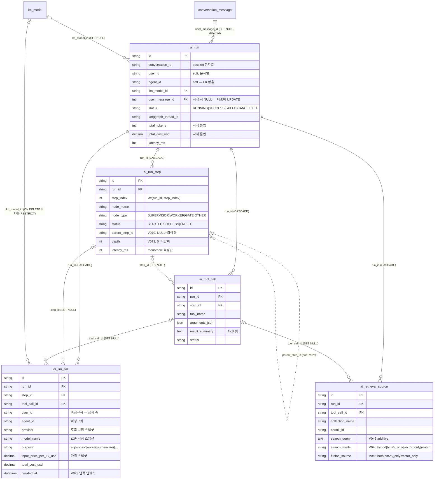

> 읽는 시점: **`ai_run_*` 5테이블을 조회·집계·삭제하거나 새 관측 컬럼을 넣기 전**, 다른 테이블에서 `run_id`로
> 실행을 가리키려 할 때, 그리고 "ORM에 FK가 없으니 DB에도 없겠지"라고 가정하기 전.

구조는 **V021 DDL 기준**이다. ORM(`agent_run.py`)은 같은 컬럼을 매핑하지만 FK를 하나도 선언하지 않는다 — 아래 각주 1.
실선=DDL 실제 FK, 점선=FK 없는 소프트 참조.

## 각주 (코드에 안 보이는 규칙)

1. **ORM에 FK가 없다 ≠ DB에 FK가 없다.** V021은 FK 11건을 걸었고 ORM은 0건이다. 이유는 `ragas/models.py:16-21`에 적힌 대로 — 공유 `Base.metadata`에 교차 모듈 FK를 두면 부분 임포트 상태의 sqlite `create_all` 픽스처가 `NoReferencedTableError`로 깨진다(approval 모델은 91 errors 실측). 그래서 **FK의 진실은 항상 마이그레이션 SQL**이다. 같은 패턴을 쓰는 테이블: `approval_request.agent_id`(V071), `agent_skill`(V034), `skill_definition.department_id`(V033), `document_template`/`document_generation_type.agent_id`(V037/V059), `evaluation_run.sweep_id/llm_model_id`(V068), `evaluation_sweep.judge_llm_model_id`(V067). 반대로 ORM에 FK가 있는 테이블(agent_definition·agent_tool·knowledge_base·agent_background_job·agent_webhook 등)은 DDL과 일치한다.
2. **`ai_run`이 보존 루트다.** `ai_run` 1행을 지우면 step·tool_call·llm_call·retrieval_source가 CASCADE로 함께 사라진다. 반면 바깥에서 `run_id`로 들어오는 참조는 **전부 FK 없는 소프트 참조**라 run 삭제 후에도 남는다: `agent_schedule_run.run_id`, `agent_background_job.run_id`, `agent_webhook_delivery.run_id`, `approval_request.run_id`([[erd-execution-triggers]]), `agent_memory.source_run_id`([[erd-agent]]), `evaluation_result.ai_run_id`([[erd-evaluation]] — V068 D11: "관측 삭제가 평가 결과를 지우면 안 된다"). 이 테이블들을 `ai_run`과 조인할 때는 **LEFT JOIN + 미발견을 N/A로 강하**가 계약이다.
3. **`ai_llm_call.llm_model_id` FK만 `ON DELETE` 미지정(=RESTRICT)이다.** 다른 llm_model 참조는 전부 SET NULL인데 이것만 아니라서, 호출 이력이 1건이라도 있는 `llm_model` 행은 **물리 삭제가 FK 에러로 막힌다**. 모델 "삭제"는 `is_active=0`으로 처리해야 한다.
4. **`user_message_id`는 시작 시 NULL이고 나중에 붙는다(deferred attach).** 사용자 메시지 저장과 run 시작의 세션이 다르기 때문에 `tracker.attach_user_message`가 별도 UPDATE로 연결한다(`general_chat/use_case.py:197`, `run_agent_use_case.py:1441`). 그래서 **진행 중인 run은 `user_message_id IS NULL`일 수 있고**, 이 컬럼으로 "메시지 → run → 근거(retrieval_source)" 역추적(`get_message_retrievals_use_case`)을 할 때 NULL은 "아직 안 붙음"과 "메시지 삭제됨(SET NULL)" 두 의미를 가진다.
5. **집계의 축은 `ai_llm_call`이지 `ai_run`이 아니다.** `user_id`·`agent_id`·`provider`·`model_name`·단가가 호출 시점 스냅샷으로 비정규화돼 있어, by-user/by-llm 집계는 이 테이블만 읽는다(V023이 `created_at` 단독 인덱스를 추가한 이유 — 기존 복합 인덱스는 leading column이 user/model이라 날짜 범위 스캔에 안 쓰임). `ai_run.total_*`는 롤업 캐시이며 `llm_model` 가격을 나중에 바꿔도 과거 비용은 재계산되지 않는다.
6. **`ai_run.agent_id`는 FK가 아니다** (`agent_definition` 삭제 후에도 run 이력 보존). 반면 `llm_model_id`는 FK다. `conversation_id`는 세션 문자열이지 테이블 키가 아니다([[erd-conversation-eval]] "세션은 테이블이 아니다").
7. **`parent_step_id`(V079)는 의도적으로 FK가 없다** — 관측은 best-effort라 부모 기록 실패가 자식 INSERT 실패로 번지면 안 된다(D-03). 기존 행은 NULL/0으로 남아 평면으로 해석된다. 계층 복원·latency 측정 규칙은 [[run-step-hierarchy-and-latency]]가 주인(여기서 반복하지 않음). 핵심만: **`ended_at - started_at`으로 latency를 다시 계산하지 말 것**(DATETIME 초 반올림으로 음수 실측).
8. **콜레이션 계열이 다르다.** V021 5테이블은 `utf8mb4_unicode_ci`를 명시했다(참조 대상 `llm_model`(V003)·`users`(V002)·`evaluation_*`(V020/V067)·`wiki_article`(V036)도 같은 계열). 반면 `agent_definition`을 참조하는 테이블군은 CHARSET/COLLATE 미명시가 규칙이다([[mysql-fk-collation]]). 따라서 **새 테이블이 `ai_run.id`나 `llm_model.id`를 VARCHAR FK로 참조하려면 `utf8mb4_unicode_ci`를 명시**해야 한다 — V067 `evaluation_sweep`이 이렇게 했다. 두 계열을 한 테이블에서 동시에 FK로 참조하는 것은 (DB 기본 콜레이션이 unicode_ci가 아닌 한) 불가능하므로, 그 경우 한쪽은 소프트 참조가 된다.
9. V021 헤더 주석 "V022 적용 이후 실행되어야 한다"는 **Flyway 순서와 모순**(V021이 먼저 실행된다). FK 대상 `llm_model`은 V003부터 존재하므로 실제로는 문제 없이 적용되며, 주석만 낡았다 — 코드가 진실.
10. 비정규화·스냅샷 컬럼(`ai_llm_call.user_id/agent_id/provider/model_name/단가`, `ai_retrieval_source.content_preview`)은 **원본이 바뀌어도 갱신하지 않는다**는 전제로 설계됐다. 관측 테이블에서 "현재 이름"을 보여주려면 조인, "당시 값"을 보여주려면 이 컬럼.
