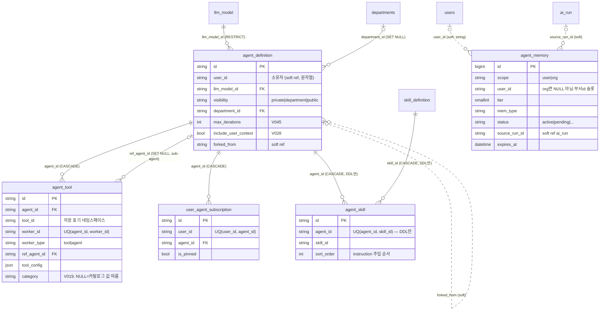

> v2 (2026-10-13): V053~V079 27건 재검증 — 이 도메인 4테이블에 닿은 마이그레이션은 **0건**이라 ERD 본체는 v1 그대로 유효.
> 변경: `agent_tool.category`(V019, ERD 누락분) 추가, `agent_skill` 참조 방식을 "모델 파일 확인"에서 **DDL 사실**로 교정
> (ORM에는 FK가 없지만 V034 DDL에는 CASCADE FK 2개 + UQ가 있다), 실행·트리거·카탈로그 테이블은 신설 ERD로 분리·링크.

구조는 SQLAlchemy 모델 + 마이그레이션 DDL에서 도출. 실선=실제 FK, 점선=FK 없는 소프트 참조.

## 각주 (코드에 안 보이는 규칙)

- **`agent_definition`·`agent_tool`은 Flyway가 만든 테이블이 아니다.** `idt/db/migration/`에 CREATE 문이 없고(V001도 없음) V007/V017이 ALTER만 한다. 그래서 DB 기본 콜레이션을 쓰며, 이 테이블을 FK로 참조하는 새 마이그레이션은 CHARSET/COLLATE를 쓰면 안 된다 ([[mysql-fk-collation]]). 같은 처지의 테이블: `conversation_message`, `conversation_summary`, `mcp_server_registry`, `middleware_agent*` 3종.
- **`user_id`는 어디서나 문자열 소프트 참조다.** `users.id`는 BIGINT라 FK를 걸 수 없다는 것이 V017 주석의 명시 결정. 사용자 삭제가 에이전트·구독·메모리로 전이되지 않는다.
- **`agent_tool.tool_id`는 저장 표기다** (`{id}`, `mcp_{srv}`). 카탈로그/폼 표기(`internal:{id}`, `mcp:{srv}:{tool}`)와 다르므로 이 테이블 값을 그대로 UI에 내보내면 안 된다 ([[router-map]] 계약 주의). 카탈로그 쪽 계약은 [[erd-tool-catalog]].
- **`agent_tool.category`(V019)는 에이전트별 예외값**이고 기본은 `tool_catalog.category`(V069)다. NULL이면 카탈로그 값, 둘 다 NULL이면 react 기본 경로.
- **`forked_from`은 FK가 아니다** — 원본 삭제 시에도 포크 이력 문자열은 남는다.
- **`agent_skill`은 ORM(`AgentSkillModel`)에 FK 선언이 없지만 DDL(V034)에는 `agent_definition`·`skill_definition` 양쪽 CASCADE FK와 `uq_agent_skill(agent_id, skill_id)`가 있다.** sqlite 테스트에서 통과했다고 중복 삽입이 운영에서 되는 게 아니다. 이 "FK는 DDL에만" 패턴의 전체 목록은 [[erd-agent-run]] 각주 참조.
- **`agent_memory`는 FK가 전혀 없다** (V050 주석: V037 선례). `user_id` 컬럼은 org scope에서 부서 식별자 슬롯으로 재사용되므로, 조회 시 **scope 가드 없이 user_id만으로 필터하면 부서 메모리가 새어 나간다** (agent-memory-org-scope 교훈).
- `agent_memory.status`는 승인 게이트 상태 머신이다: 추출 후보=pending → 승인 시 active (agent-memory-extraction). 행 존재≠주입 대상.
- Phase 2/3 컬럼(scope/tier/status/source_run_id/confidence/expires_at)은 V050에서 **선반영**되어 이후 마이그레이션 0으로 진행됐다 — 확장 예정 컬럼 선반영 패턴의 선례.
- **이 문서가 주인이 아닌 인접 테이블** (한 곳만 주인, 여기는 링크):
  - 실행 관측 `ai_run`·`ai_run_step`·`ai_tool_call`·`ai_llm_call`·`ai_retrieval_source` → [[erd-agent-run]]
  - 실행 트리거·승인 `agent_schedule`·`agent_schedule_run`·`agent_background_job`·`agent_webhook`·`agent_webhook_delivery`·`approval_request` → [[erd-execution-triggers]]
  - 카탈로그 `tool_catalog`·`mcp_server_registry`·`middleware_catalog`·`agent_middleware`·`skill_definition` → [[erd-tool-catalog]]
  - 에이전트당 워커 설정 `document_template`·`document_generation_type` → [[erd-document-tooling]]
  - 프롬프트 생성 이력 `prompt_session`·`prompt_version` → [[erd-prompt-composer]]
