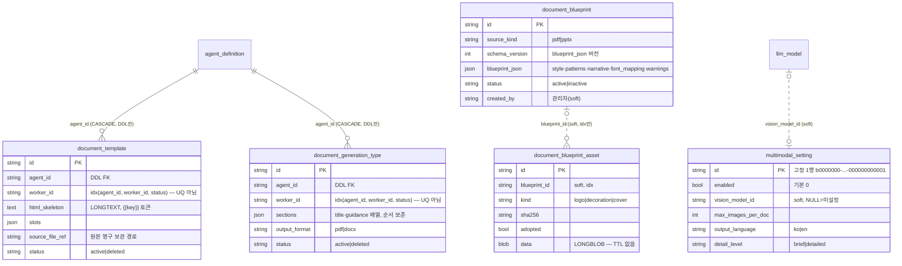

> 읽는 시점: **에이전트 워커(추출기·생성기)에 "에이전트별 설정 1개"를 저장하는 테이블을 추가하거나 고치기 전**,
> 블루프린트/에셋을 지우거나 옮길 때, 비전 모델 선택 드롭다운이 비어 보일 때, 전역 설정 테이블을 새로 만들려 할 때.

두 묶음이다. (A) 에이전트·워커 전용 설정 — `document_template`(V037)·`document_generation_type`(V059)은 **같은 설계(D4)를 복제**한 쌍. (B) 전역 자산·설정 — `document_blueprint(+asset)`(V066)·`multimodal_setting`(V065)은 에이전트와 무관.
실선=DDL 실제 FK(ORM에는 미선언), 점선=소프트 참조.

## 각주 (코드에 안 보이는 규칙)

### (A) 에이전트·워커 전용 설정 — D4 패턴
- **`(agent_id, worker_id)`에 UQ를 두지 않은 건 결정**(V037 D4, V059가 복제): soft-delete(`status=deleted`) 후 재등록이 UQ와 충돌하기 때문. 대신 **"워커당 active 1개"는 저장 UseCase가 보장**한다(기존 active를 deleted로 바꾼 뒤 insert). 즉 DB는 active 2개를 막지 않는다 — 동시 등록 경합이나 raw INSERT로 깨질 수 있으니 조회는 항상 `status='active'` + 최신 1건으로 읽을 것. 같은 모양의 테이블을 추가할 때 이 패턴을 그대로 따르고, UQ를 넣고 싶으면 soft-delete를 포기해야 한다.
- 워커가 어떤 템플릿/유형을 쓰는지(`type_id`, MCP html_to_doc tool id 등)는 **이 테이블이 아니라 `agent_tool.tool_config`에** 있다(추출기 동형). 테이블은 본문만 가진다.
- `agent_id` FK는 DDL에만 있고 ORM엔 없다([[erd-agent-run]] 각주 1). 에이전트 삭제 시 CASCADE로 함께 사라진다.
- `html_skeleton`은 DDL LONGTEXT, ORM `Text` — 읽기/쓰기 호환이라 의도된 불일치(모델 주석).

### (B) 전역 자산·설정
- **`document_blueprint_asset.blueprint_id`는 FK가 아니다**(인덱스만). 블루프린트를 지울 때 에셋을 앱이 함께 지우지 않으면 LONGBLOB 고아가 남는다. 에셋은 `AttachmentStore`(TTL 삭제) 대신 **DB에 영구 보관**하기로 한 결정(D2)이라 용량이 계속 는다 — 정리 잡이 없다.
- `document_blueprint.schema_version`은 `blueprint_json` 구조 버전이다 — [[erd-prompt-composer]]의 `prompt_version.schema_version`과 같은 "읽기 분기, 백필 없음" 계약.
- **`multimodal_setting`은 단일 행 테이블**이다. V065가 고정 id(`MULTIMODAL_SETTING_ID`)로 시드하며 앱은 **INSERT하지 않고 그 행만 UPDATE**한다. 행이 없으면(마이그레이션 미적용) 설정 조회가 실패한다 — [[migration-deploy-deps]]. 범위 검증(상한·비율)은 DB가 아니라 도메인 VO `MultimodalSettings.__post_init__` 단일 출처.
- `vision_model_id`는 `llm_model` 소프트 참조(`chunking_profile.summary_llm_model_id` 선례, [[erd-kb]]). 드롭다운은 **`is_active=1 AND supports_vision=1`**만 노출한다(V064). 시드 모델(gpt-4o·4o-mini·claude-*)만 백필됐으므로 **관리자가 직접 등록한 모델은 `supports_vision=0`으로 시작**해 드롭다운에 안 보인다 — "비전 모델이 없다"는 문의의 첫 확인 지점.
- 열거형 컬럼(`source_kind`, `kind`, `output_language`, `detail_level`, `status`)은 전부 VARCHAR + 앱 검증이다 — ENUM은 값 추가마다 ALTER가 필요해 additive 확장을 막는다는 정책(V063/V065 주석, [[additive-contract-extension]]).
