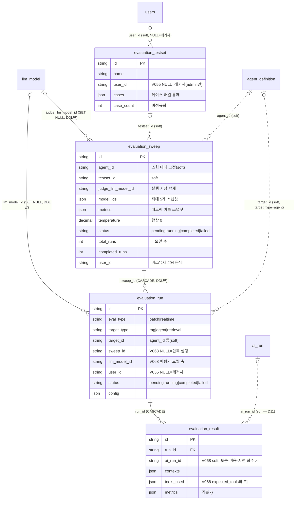

> 읽는 시점: **`/api/ragas/*` 조회 쿼리를 새로 쓰거나 평가 결과를 다른 테이블과 조인하기 전**, 스윕/단독 실행을
> 집계할 때, 평가 이력의 보존·삭제 범위를 정할 때. 사용자 👍/👎(`message_feedback`)는 [[erd-conversation-eval]]이 주인 — 이름이 비슷하지만 다른 도메인.

실선=DDL 실제 FK(ORM에는 `result.run_id`만 선언), 점선=소프트 참조. 4테이블 모두 `utf8mb4_unicode_ci`를 **명시**한다(V020/V067) — `llm_model`과 같은 계열이라 FK가 성립한다([[erd-agent-run]] 각주 8).

## 각주 (코드에 안 보이는 규칙)

- **`user_id IS NULL`은 "레거시, admin만 열람"**이다(V055). 일반 사용자 쿼리는 `user_id = :me`로 좁히므로 NULL 행이 자동 제외되고, admin 쿼리만 전체를 본다. 사용자 삭제 시에도 이력을 남기기 위해 FK를 걸지 않았다(message_feedback 선례). 새 목록 API는 **이 두 모드를 명시적으로 분기**해야 한다.
- **`sweep_id IS NULL`이 "단독 실행"의 정의**다(D8). 대시보드는 스윕 소속 run을 제외하려고 이 조건을 쓰는데, **사용자 목록은 같은 필터를 빼먹어 QA에서 발견(G-11)**됐다 — `evaluation_run`을 읽는 새 쿼리는 "스윕 run 포함/제외"를 반드시 결정하고 테스트로 고정할 것.
- **`ai_run_id`에 FK를 걸지 않은 건 결정(D11)**: 관측 데이터(`ai_run`)는 보존정책상 먼저 지워질 수 있고, 그 삭제가 평가 결과를 지우면 안 된다. 조인 실패 시 **토큰·비용·지연만 N/A로 낙하**하고 메트릭은 그대로 보인다(dangling id 무중단 확인됨). [[erd-agent-run]] 각주 2의 소프트 참조 목록에 포함.
- **스윕은 재현성 스냅샷의 단일 지점**(D3)이다 — `model_ids`·`metrics`·`judge_llm_model_id`·`temperature(0 고정)`·`testset_id`를 생성 시 박제하고, 자식 `evaluation_run`은 `llm_model_id`만 다르다. 스윕 생성 후 테스트셋을 고쳐도 스윕 결과의 "당시 케이스"는 복원되지 않는다(`cases` JSON은 testset 쪽에만 있음) — 재현이 필요하면 testset을 복제해 쓸 것.
- 삭제 범위: 스윕 삭제 → run → result CASCADE. 단독 run 삭제 → result CASCADE. **testset 삭제는 아무것도 지우지 않는다**(소프트 참조) — 스윕 상세에서 testset이 사라졌을 수 있음을 UI가 다뤄야 한다.
- `judge_llm_model_id`·`llm_model_id`는 SET NULL FK라 모델 행 삭제 후 NULL이 된다. 단 `ai_llm_call`의 RESTRICT FK 때문에 호출 이력이 있는 모델은 애초에 삭제가 막힌다([[erd-agent-run]] 각주 3).
- `evaluation_run.target_id`는 `target_type`에 따라 의미가 바뀌는 다형 컬럼(agent면 agent_id)이라 FK가 없다. `evaluation_sweep.agent_id`도 소프트 — 에이전트 삭제 후에도 벤치마크 이력은 남는다.
- ORM에 교차 모듈 FK(`sweep_id`, `llm_model_id`, `judge_llm_model_id`)를 두지 않은 이유는 `ragas/models.py:16-21` 주석 — sqlite `create_all` 픽스처 보호. DB에는 있다.
