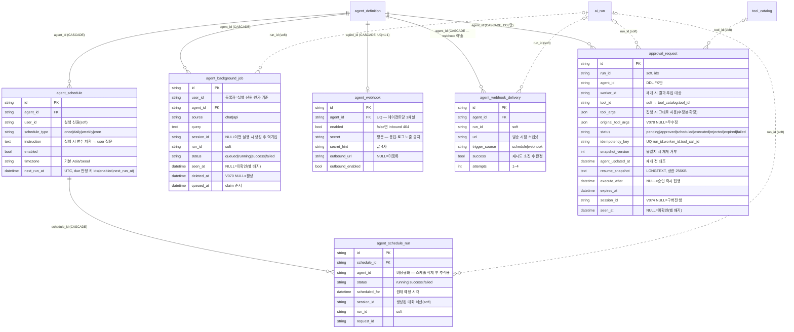

> 읽는 시점: **에이전트를 "지금 채팅" 외의 경로로 실행시키는 기능(스케줄·백그라운드 잡·웹훅·승인 후 재개)을
> 추가·수정하기 전**, 작업함/알림 벨 집계를 건드릴 때, 승인 요청의 상태 전이·멱등을 다룰 때.
> 런타임 계약(게이트 직후 END·결정적 답변)은 [[approval-gate-run-contract]], 워커·claim 메커니즘은 [[db-queue-inprocess-worker]]가 주인이다 — 여기는 **테이블 계약**만.

6테이블 전부 `agent_definition`에 CASCADE로 매달린다(에이전트 삭제 = 트리거·이력 전부 삭제). 실행 결과는 `run_id`로 `ai_run`을 **소프트 참조**한다([[erd-agent-run]] 각주 2).
실선=DDL 실제 FK, 점선=소프트 참조. 모든 DATETIME은 **UTC naive**(V071 주석 — schedule·background_job 관례 동일).

## 각주 (코드에 안 보이는 규칙)

### 공통
- **선점은 전부 `FOR UPDATE SKIP LOCKED`** — `agent_schedule.claim_due`, `background_job.claim_queued`, `approval.claim_due`. 인덱스는 그 스캔 모양대로 잡혀 있다: `idx_bg_job_claim(status, queued_at)`, `ix_approval_request_due(status, execute_after)`, `idx_agent_schedule_due(enabled, next_run_at)`. 새 claim 조건을 추가하면 **인덱스 선두 컬럼부터 다시 맞출 것**.
- **`seen_at`(NULL=미확인)은 `agent_background_job`과 `approval_request`가 동형**이다(V071 주석 "agent_background_job 동형"). 알림 벨 집계는 두 테이블의 `count_unseen` 합이므로, 한쪽에만 `mark_seen`을 넣으면 배지가 안 꺼진다.
- `request_id`는 전 테이블에 있고 **로그 상관관계용**이다(FK·UQ 아님).
- `run_id`·`session_id`가 NULL인 행은 "실행 측이 아직 발급 안 함/실패"다 — NOT NULL로 조이면 큐 등록 자체가 실패한다.

### agent_schedule / agent_schedule_run (V038)
- `agent_schedule_run.agent_id`는 **비정규화**(FK 없음) — 스케줄을 지워도(CASCADE로 run 행도 지워지지만) 지우기 전 이력 조회가 agent 축으로 가능하도록. 스케줄은 포크 시 **복사되지 않는다**(R5: agent_definition 컬럼이 아닌 별도 테이블인 이유).
- `next_run_at`은 UTC지만 사용자 입력(`time_of_day`, `days_of_week`)은 `timezone` 기준이다. 변환은 앱이 하며 DB에 로컬 시각이 섞여 있지 않다.

### agent_background_job (V060, V070)
- **물리 삭제 금지 → `deleted_at` 소프트 삭제**(V070). 이유: `run_id`로 이어지는 `ai_run` 추적과 감사 이력이 끊긴다. 조회 필터는 앱이 건다(`_active()` 헬퍼). 복구 UI는 범위 밖.
- `session_id`는 등록 시 NULL일 수 있고 실행 시 생성 후 **역기입**된다 — "세션으로 활성 잡 찾기"(`find_active_by_session`)는 등록 직후엔 못 찾는다.
- 기동 시 `reconcile_orphan_running`이 `running` 고아를 `failed`로 정리한다 — 서버 재시작 중 죽은 잡은 자동 재시도되지 않는다.
- ORM이 선언한 인덱스(user_id/agent_id/status 단독 + V070 복합)와 DDL 인덱스(V060 복합 3개 + V070)가 **다르다**. 운영 DB는 Flyway가 진실이고 ORM 선언은 sqlite 테스트에만 영향 — 쿼리 플랜을 ORM 보고 추정하지 말 것.

### agent_webhook / agent_webhook_delivery (V057, V058)
- **시크릿은 평문 저장이 결정**이다(D2: HMAC 서명 재계산에 원문 필요, 해시와 양립 불가; `mcp_server_registry` api_key 보관과 동급). 응답·로그에는 `secret_hint`(끝 4자)만. 유출 대응은 rotate.
- `agent_webhook_delivery`의 FK는 `agent_webhook`이 아니라 `agent_definition`이다 — **채널 삭제·재발급 후에도 발송 이력이 남는다**. 불변 레코드(INSERT only), `url`은 발송 시점 스냅샷.
- `enabled=false`는 inbound를 **404**로 숨긴다(401/403 아님).

### approval_request (V071, V074, V078)
- **ORM에 `agent_id` FK가 없는 건 의도**다(모델 주석: 공유 metadata가 `agent_definition`→`departments` FK까지 연쇄 요구해 sqlite 통합 테스트 91건 붕괴). DDL에는 CASCADE FK가 있다 — 에이전트 삭제 시 대기 중 승인도 사라진다.
- **멱등 2중 저지선**: (1) `UNIQUE idempotency_key`(= `run_id:worker_id:tool_call_id`)로 같은 도구 호출의 pending 중복 생성 차단, (2) `compare_and_set_status` 조건부 UPDATE로 동시 승인 10회 → 집행 1회(SC-8). **"런당 활성 1건" 불변식은 DB 제약이 아니라** `find_active_by_run`(`_ACTIVE_STATUSES = pending|approved|scheduled`)으로 앱이 보장한다.
- 상태 전이: `pending → approved → (execute_after 있으면) scheduled → executed | failed`, `pending → rejected`, `pending|scheduled → expired`(`expire_overdue`). `failed`는 **자동 재시도 없음**(컬럼 주석). `executed` 후 정산은 런타임 계약 문서 참조.
- **재개 안전장치 2개는 컬럼으로 박혀 있다**: `snapshot_version` 불일치 → 재개 거부, `agent_updated_at` ≠ 현재 `agent_definition.updated_at` → 재개 전 대조. 에이전트 정의를 바꾸면 대기 중 승인은 재개가 막힐 수 있다 — 사용자 안내가 필요한 지점.
- `session_id`(V074)는 **구버전 행이 NULL**이고 그 경우 "재개는 하되 답변 저장은 건너뛴다". 이 컬럼이 없어서 `SessionId("")` 예외로 최종 답변이 유실된 것이 Check G1 결함이었다.
- `tool_args`가 집행 입력이다. 담당자가 수정 승인하면 **수정본이 `tool_args`/`draft`에 덮어써지고 원본이 `original_tool_args`로 이동**한다(V078). `original_tool_args/edited_by/edited_at` 셋 다 NULL = 무수정. "원본은 tool_args, 수정본은 별도 컬럼"으로 짐작하면 반대다.
- `tool_id`는 **카탈로그 표기**(`tool_catalog.tool_id`)로 저장되며 `agent_tool.tool_id`(저장 표기)와 다르다([[erd-agent]] 각주, [[erd-tool-catalog]]).
- 발동 조건의 SoT는 `tool_catalog.requires_approval`(V072)이다. 미들웨어 축(`middleware_catalog.approval_gate`, V073)은 `execute_after`·`expires_hours` 같은 설정값만 공급하고, 미설정이어도 fail-closed 기본 게이트가 선다 — [[approval-gate-run-contract]].
- DDL은 `DEFAULT CHARSET=utf8mb4`만 쓰고 COLLATE를 생략해 `agent_definition`과 같은 DB 기본 콜레이션을 상속한다([[mysql-fk-collation]]).
