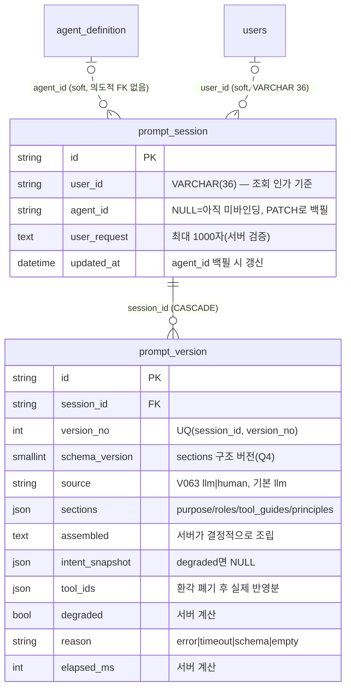

> 읽는 시점: **prompt-composer·에이전트 생성 위저드·pipeline이 남기는 이력을 조회·확장하기 전**, `sections` JSON
> 구조를 바꾸려 할 때, "에이전트를 지웠는데 세션이 남아 있다"를 만났을 때. LLM 출력 필드(degraded 등)를 스키마에
> 두지 않는 규칙은 [[llm-output-trust-boundary]]가 주인.

2테이블. `prompt_session`은 **Flyway 테이블 중 드물게 FK가 0개**이고, `prompt_version`만 세션에 CASCADE로 매달린다.

## 각주 (코드에 안 보이는 규칙)

- **`agent_id`에 FK를 걸지 않은 건 결정**이다(V061 주석): 에이전트 삭제가 이력 삭제로 전이되면 "왜 이 프롬프트가 나왔는가"의 기록이 사라진다. 정합성은 `PATCH /prompt-composer/sessions/{id}` 백필 API가 담당한다. 따라서 **`agent_id`가 존재하지 않는 에이전트를 가리키는 세션은 정상 상태**다(삭제된 에이전트의 이력).
- **생성 시점엔 `agent_id`가 NULL**이다(D5: 프롬프트는 에이전트 저장 전에 만들어진다). 위저드/파이프라인이 에이전트를 저장한 뒤 PATCH로 묶는다. "에이전트별 프롬프트 이력"을 조회하면 백필 전 세션은 보이지 않는다.
- **`UQ(session_id, version_no)`가 동시 재생성의 중복을 DB에서 막는다**(E10). version_no는 앱이 `MAX+1`로 매기므로 경합 시 한쪽이 IntegrityError를 받는다 — 재시도 책임은 호출자.
- **`schema_version`은 "지금 넣는 비용 0, 나중에 넣으면 전 행 백필"이라 선반영**했다(Q4). `sections` JSON 구조를 바꾸면 이 값을 올리고 **읽기 경로에서 분기 파싱**해야 한다 — 과거 행을 마이그레이션으로 고치지 않는 것이 계약이다.
- `source`(V063)는 ENUM이 아니라 VARCHAR(10)이다 — additive 확장을 막지 않기 위해. 기본 `llm`이라 기존 행은 자동 백필됐고, 위저드가 사용자 편집본을 쌓을 때만 `human`을 쓴다. 값 검증은 앱 레이어.
- `degraded`·`reason`·`elapsed_ms`·`tool_ids`는 **서버가 계산해 저장한 값**이지 LLM 출력이 아니다. LLM 스키마에 이 필드를 두면 오염된다는 것이 [[llm-output-trust-boundary]]의 실사례(이 테이블이 그 소비자).
- `user_id`가 **VARCHAR(36)**이다 — 다른 테이블의 `user_id`는 대부분 VARCHAR(100)/(255). 현재 사용자 id는 숫자 문자열이라 문제없지만, 길이가 다른 컬럼끼리 조인·비교하는 raw SQL에서는 인덱스 사용 여부를 확인할 것.
- 배포 의존: V061/V062 없이는 prompt-composer뿐 아니라 agent-create-pipeline("마이그레이션 0")도 깨진다 — [[migration-deploy-deps]].
