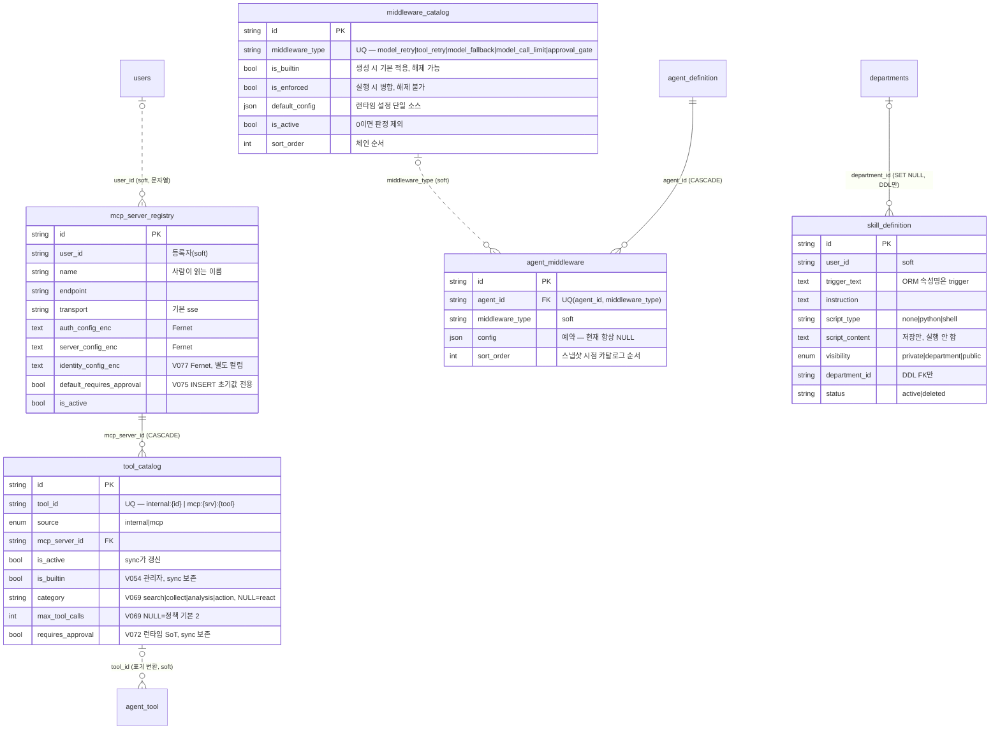

> 읽는 시점: **`tool_catalog`에 관리자 설정 컬럼을 추가하거나 sync(upsert) 로직을 고치기 전**, MCP 서버 등록·수정 흐름을
> 만질 때, 미들웨어를 추가하거나 "기본 적용 vs 강제 적용"을 설계할 때, `middleware_agent`와 `agent_middleware`를
> 헷갈렸을 때. 빌트인 opt-out 구조는 [[builtin-tools-optout-channel]], MCP 런타임 객체 형태는 [[mcp-runtime-tool-shape]]가 주인.

세 카탈로그(도구·미들웨어·스킬)는 서로 FK가 없다. 에이전트와의 연결은 `agent_tool`·`agent_middleware`·`agent_skill`이 담당하며 그중 `agent_tool`·`agent_skill`은 [[erd-agent]]가 주인.
실선=DDL 실제 FK, 점선=소프트 참조.

## 각주 (코드에 안 보이는 규칙)

### tool_catalog (V006 → V054/V069/V072)
- **"관리자 지정, sync 보존" 컬럼 4개: `is_builtin`, `category`, `max_tool_calls`, `requires_approval`.** 부팅 sync·MCP 재sync의 upsert는 `UPDATE SET name, description, is_active, updated_at`만 한다(`tool_catalog_repository.py:65-73`). 보존은 "SET 절에 **추가하지 않음**"으로 성립하고 테스트가 이를 고정한다. 새 관리자 컬럼을 추가하면 **SET 절에 넣지 말고 보존 테스트를 1건 추가**하는 것이 계약이다. 신규 INSERT 시 초기값은 `ToolMeta.builtin_default`/`requires_approval_default`(internal) 또는 `mcp_server_registry.default_requires_approval`(mcp).
- `tool_id`는 **카탈로그 표기**(`internal:{id}`, `mcp:{server_id}:{tool}`)다. `agent_tool.tool_id`(저장 표기 `{id}`, `mcp_{srv}`)와 다르고 FK도 없다 — 변환은 앱이 한다([[router-map]] 도구 ID 이중 네임스페이스).
- `mcp_server_id` FK CASCADE: **서버 행을 지우면 카탈로그 엔트리가 같이 사라진다**(그 도구를 쓰던 `agent_tool` 행은 소프트 참조라 남는다 → 런타임에 도구 미발견). 서버 **비활성화**는 sync가 `is_active=0`으로 반영한다(mcp-tool-auto-sync Q5 — 실DB 검증은 G-02로 이월).
- MCP 엔트리는 `POST /tool-catalog/sync`를 아무도 호출하지 않아 **영원히 안 생기던 결함**이 있었다. 지금은 서버 등록/수정 UseCase가 같은 DB 세션으로 sync를 호출하되 `SQLAlchemyError`만 재전파하고 나머지는 흡수(best-effort, 201 유지)한다. 즉 **등록 성공 ≠ 카탈로그 반영 성공** — 응답의 `tool_sync` 필드와 서버별 [동기화] 버튼이 복구 경로.
- `category`·`max_tool_calls`는 도구 단위 기본값이고 에이전트별 예외는 `agent_tool.category`(V019)다. 둘 다 NULL이면 react 기본 경로(FR-14) — 백필하지 않았으므로 기존 에이전트 동작은 값이 지정된 도구에서만 바뀐다.

### mcp_server_registry (create_all; V032/V075/V077)
- **Flyway CREATE가 없다** — `agent_definition`과 같은 create_all 계열이라 DB 기본 콜레이션을 쓴다. V006 `tool_catalog`이 CHARSET만 명시하고 COLLATE를 뺀 이유.
- 서버는 **사용자별 등록**(`user_id` 소프트 참조)이고 sync는 등록 건마다 카탈로그 엔트리를 만든다. 그래서 `default_requires_approval`(V075)이 필요했다: 새 사용자가 발송 도구를 등록해도 관리자가 찾아 켜기 전까지 승인 없이 실행되는 구멍. 이 값은 **엔트리 신규 INSERT 때 1회 복사**되고 기존 엔트리에 소급하지 않는다(D-07). 런타임 SoT는 여전히 `tool_catalog.requires_approval`.
- 비밀 3컬럼은 Fernet 암호문이며 **`identity_config_enc`를 `auth_config_enc`와 분리한 이유**: PUT이 `auth_config`를 통째로 교체하므로 같은 JSON에 두면 API 키만 바꿔도 서명 비밀이 지워진다(V077). 새 비밀 종류를 추가할 때도 같은 이유로 컬럼을 분리할 것.
- 신원 헤더의 클레임 소스는 **`users.mailbox_upn`(V076)**이지 도구 인자가 아니다 — LLM·메일 본문이 타인 메일함을 고를 경로를 없애기 위해서. NULL이면 신원 필요 도구는 서버 호출 전에 거부된다. 로그인 `email`과 독립.
- 런타임에서 서버명은 `mcp_{uuid}`로만 보인다 — [[mcp-runtime-tool-shape]].

### middleware_catalog / agent_middleware (V056, V073)
- **시드 = 유일한 공급원**(부팅 sync 없음, D3). 미들웨어 유형 추가는 코드 + 새 마이그레이션 INSERT 한 쌍이다(V073 `approval_gate`가 선례). `middleware_type`은 UQ라 재실행 시 중복 INSERT가 막힌다.
- `is_builtin`과 `is_enforced`는 다른 축이다: builtin은 **생성 시 `agent_middleware` 행으로 스냅샷**(사용자 해제 가능), enforced는 **실행 시 스냅샷과 무관하게 병합**(해제 불가, 행이 없어도 적용). `is_active=0`이면 둘 다 판정에서 빠진다. 1차 시드는 model_retry·tool_retry만 builtin, enforced는 전부 off.
- `agent_middleware`는 **행 존재 = 적용**이고 폼 수정 시 전체 교체다. `config`는 예약 컬럼(항상 NULL) — 설정의 단일 소스는 `middleware_catalog.default_config`뿐이므로 "에이전트별 재시도 횟수" 같은 요구는 아직 스키마가 없다.
- `sort_order`는 체인 순서다. `approval_gate`가 100인 이유: `model_call_limit`(40) 등이 먼저 걸러낸 뒤 판정해야 하므로 **체인 마지막**이어야 한다. 새 미들웨어의 순서를 정할 때 게이트 뒤에 두면 승인 없이 실행되는 경로가 생긴다.

### skill_definition (V033) + agent_skill
- DB 컬럼은 `trigger_text`, ORM 속성은 `trigger`(MySQL 예약어 회피). raw SQL을 쓸 때 `trigger`로 적으면 문법 에러.
- `department_id` FK는 **DDL에만**(ORM 없음, [[erd-agent-run]] 각주 1 패턴). `script_content`는 저장 전용이며 실행 경로가 없다(Phase A).
- 에이전트 부착은 `agent_skill`(V034: 양쪽 CASCADE FK + UQ, ORM에는 미선언) — [[erd-agent]].

### middleware_agent / middleware_agent_tool / middleware_config — 이름 함정
- **`agent_middleware`(V056, agent_definition의 미들웨어 스냅샷)와 `middleware_agent`(레거시 `/api/v2/agents` 자동 빌더의 별도 에이전트 모델)는 전혀 다른 테이블**이다. 후자 3종은 Flyway CREATE가 없는 create_all 계열이고 `agent_definition`과 FK·공유 컬럼이 없다(`model_name` 문자열 직저장, `llm_model` 미참조). 새 기능은 `agent_definition` 축에만 붙일 것 — [[architecture-overview]].
